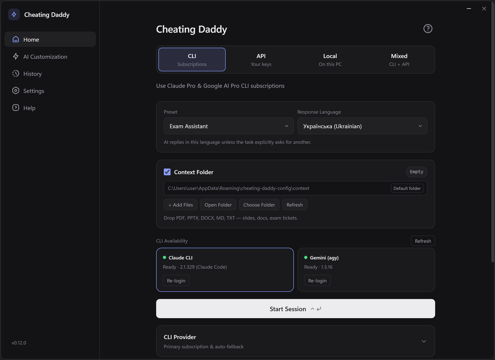
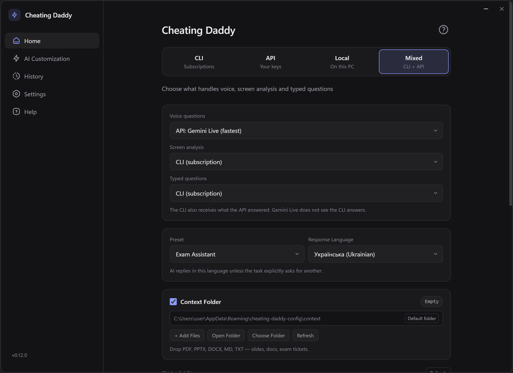
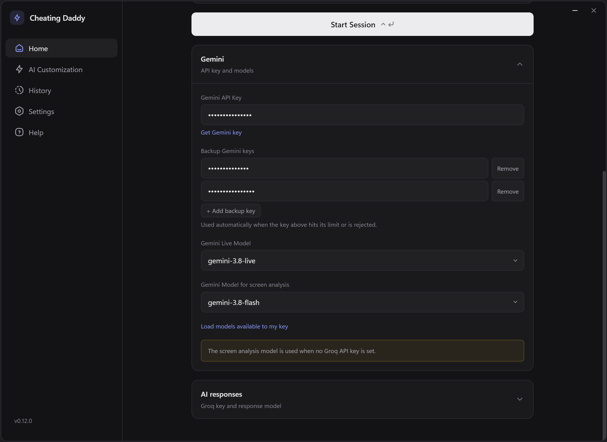
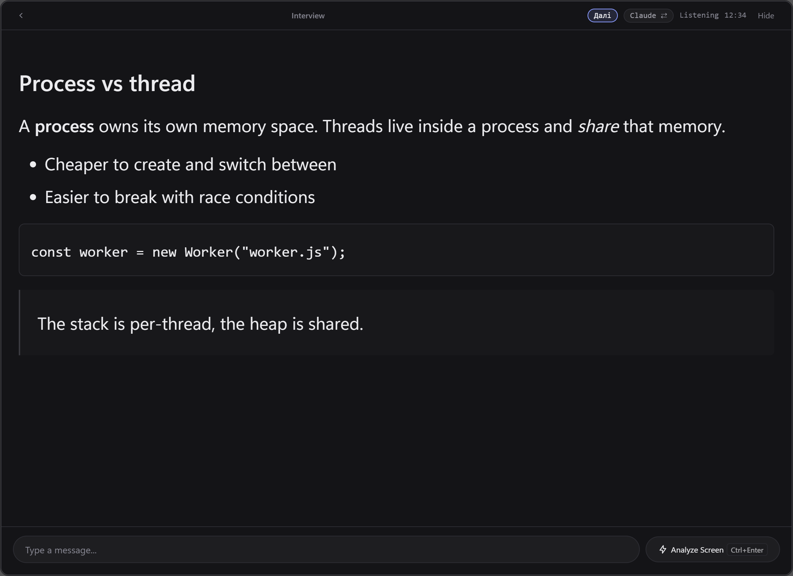
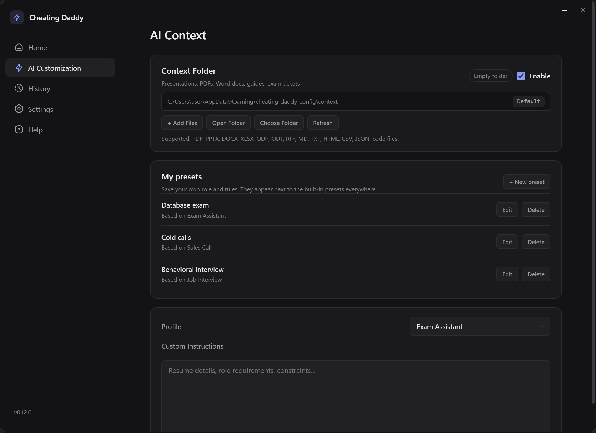
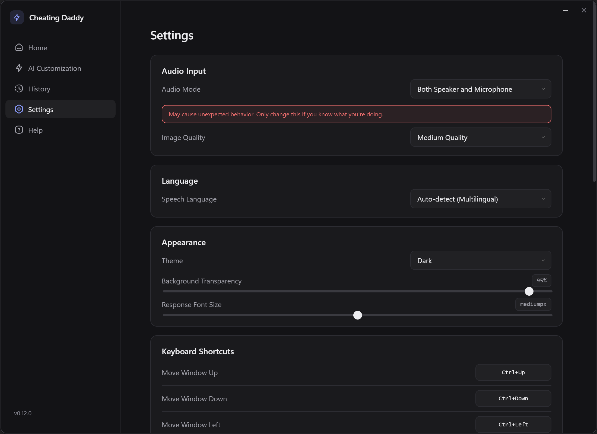
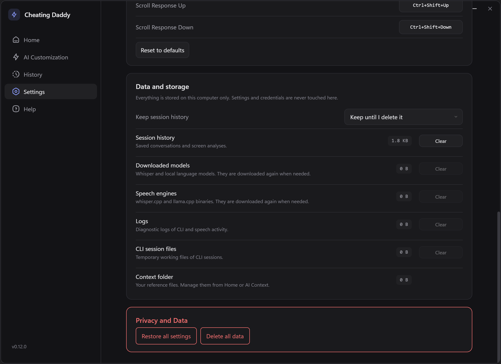

<div align="center">


# Cheating Daddy

**CLI & Offline Whisper Edition**

A transparent real-time desktop assistant that listens, watches your screen, and answers
using your own **Claude Pro** or **Google AI Pro** subscription, your own **API keys**, a mix of both — or fully offline.

[](https://github.com/Jenakonda/cheating-daddy-Modify/releases)
[](LICENSE)


[**Download**](https://github.com/Jenakonda/cheating-daddy-Modify/releases) ·
[Quick start](#-quick-start) ·
[Features](#-features) ·
[Shortcuts](#-keyboard-shortcuts) ·
[Privacy](#-privacy--local-data)

<br />



</div>

<br />

## ✨ Features

|                             |                                                                                                                             |
| --------------------------- | --------------------------------------------------------------------------------------------------------------------------- |
| 🖥️ **Transparent overlay**  | Always-on-top window with content protection — hidden from screen shares and screenshots on Windows.                        |
| 🎙️ **Local voice-to-text**  | `whisper.cpp` with Vulkan GPU acceleration and a safe CPU fallback. No STT API keys.                                        |
| 🧠 **Bring your own AI**    | Claude Code CLI, Google Antigravity CLI (`agy`), Gemini / Groq keys, or a local GGUF model.                                 |
| 🔀 **Mixed mode**           | Choose per task: for example voice over Gemini Live and screen analysis through your CLI subscription.                      |
| 🔑 **Backup API keys**      | Add any number of Gemini and Groq keys; the next one takes over when a key is rate-limited or rejected.                     |
| 🎛️ **Model choice**         | Pick the Gemini models yourself, type any model ID, or load the list your key can use.                                      |
| 🔁 **Live provider switch** | Swap between Claude and Gemini mid-session with context preserved, plus auto-fallback on rate limits.                       |
| 📂 **Context folder**       | Drop slides, PDFs, docs and notes — answers are grounded in your own material.                                              |
| 🎯 **Presets**              | Job interview, exam, meeting, sales call, presentation, negotiation — plus your own custom presets with saved instructions. |
| 📝 **Live transcript**      | See what was heard (You / Speaker). Fix a misheard word with **Edit**, or send a line to the AI with **Ask**.               |
| 📋 **Copy & export**        | Copy any answer, or export a whole session from History as a Markdown file.                                                 |
| 🟢 **Subscription status**  | A status dot on the provider pill shows whether Claude or Gemini is working, rate-limited or needs sign-in.                 |
| 🗂️ **Data control**         | See what is stored and how big it is, clear it by category, and auto-delete old history after 7, 30 or 90 days.             |
| 🌍 **Multilingual**         | Auto-detect speech language; pick the response language (including Ukrainian).                                              |
| 🎤 **Better recognition**   | Switch to the Large v3 Turbo model for non-English speech and add vocabulary hints for names and terms.                     |
| ⌨️ **Keyboard-first**       | Every action has a customizable global shortcut.                                                                            |

<br />

<div align="center">






</div>

<br />

## 🚀 Quick start

### Option 1 — Windows installer or portable ZIP (no Node.js needed)

1. Download **`Cheating-Daddy-Setup.exe`** (installer) or **`Cheating Daddy-win32-x64-*.zip`** (portable) from the [**Releases**](https://github.com/Jenakonda/cheating-daddy-Modify/releases) page.
2. Run the installer, or extract the ZIP and start `Cheating Daddy.exe`.
    > First launch on an unsigned build: Windows SmartScreen → **More info** → **Run anyway**.
3. On **Home**, pick a mode with the tabs at the top:
    - **CLI:** under **CLI Availability**, click **Install & Sign In** on the **Claude CLI** or **Gemini (`agy`)** card. The CLI is installed and you sign in with your subscription in one click.
    - **API:** open the **Gemini** section and paste your [API key](https://aistudio.google.com/apikey).

### Option 2 — Run from source

<details>
<summary><b>Show developer setup</b></summary>

<br />

**Prerequisites:** [Node.js](https://nodejs.org/) v20+ and, for CLI mode, at least one subscription CLI:

| CLI                                   | Install                                                                                                     |
| ------------------------------------- | ----------------------------------------------------------------------------------------------------------- |
| **Claude Code** (Claude Pro / Max)    | `irm https://claude.ai/install.ps1 \| iex` or `npm install -g @anthropic-ai/claude-code`, then run `claude` |
| **Antigravity `agy`** (Google AI Pro) | `irm https://antigravity.google/cli/install.ps1 \| iex`, then run `agy` (macOS / Linux: `install.sh`)       |

```bash
git clone https://github.com/Jenakonda/cheating-daddy-Modify.git
cd cheating-daddy-Modify
npm install
npm start
```

> **npm 11+:** if launching fails with `Electron binary not found`, run `node node_modules/electron/install.js` once.

| Command             | What it does                                                  |
| ------------------- | ------------------------------------------------------------- |
| `npm start`         | Console-less launch (or double-click `Start-Silent.vbs`)      |
| `npm run start:dev` | Development launch with terminal logs                         |
| `npm test`          | Run the automated test suite                                  |
| `npm run make`      | Build the Windows installer and portable ZIP into `out/make/` |

</details>

<br />

## 🤖 AI provider modes

| Mode                | Needs                       | Good for                                                                   |
| ------------------- | --------------------------- | -------------------------------------------------------------------------- |
| **CLI** _(default)_ | Claude Pro / Google AI Pro  | No API keys. Claude models + effort, all live `agy` models, auto-fallback. |
| **API**             | Gemini Live / Groq API keys | The fastest voice answers, with your own keys and the models you choose.   |
| **Local AI**        | Nothing — runs on your PC   | Fully offline: `llama.cpp` language model + `whisper.cpp` transcription.   |
| **Mixed**           | A CLI and API keys          | A different provider for voice questions, screen analysis and typed input. |

Switch modes with the tabs at the top of **Home**.

**API and Mixed modes**

- **Models.** The defaults are `gemini-3.8-live` (voice) and `gemini-3.8-flash` (screen analysis). Google retires models from time to time: choose another one on Home. A busy screen analysis model is retried and then replaced by a backup model, and the answer says so.
- **Backup keys.** Press **+ Add backup key** under Gemini or Groq. Google counts Gemini limits per project, so keys from the same project share one quota.
- **Long sessions.** A dropped Gemini Live connection is reconnected and the conversation resumed.
- **Mixed mode context.** The CLI receives what the API answered. Gemini Live does not see CLI or screen analysis answers.

<br />

## 🎙️ Offline voice transcription

Verified `whisper.cpp` binaries and quantized models (`small-q5_1`, `base-q5_1`, `large-v3-turbo-q5_0`, …) are downloaded automatically on first launch. Vulkan GPU acceleration is enabled on supported Windows GPUs and falls back to CPU (`-ng`) if GPU initialization fails.

| Audio input mode        | Captures                                                                                                                                                                  |
| ----------------------- | ------------------------------------------------------------------------------------------------------------------------------------------------------------------------- |
| **System audio only**   | Remote speakers (Zoom, Meet, browser output).                                                                                                                             |
| **Microphone only**     | Your own voice.                                                                                                                                                           |
| **Microphone + system** | Both. Your speech is buffered quietly as _silent microphone context_ and attached when the other side replies — or press **Continue** to get a 1–2 sentence continuation. |

<br />

## 📂 Context folder

Drop files into the context folder right from **Home** or **AI Context**.

- **Formats:** `.pptx` (slides + speaker notes), `.odp`, `.pdf` (per page, Unicode-safe), `.docx`, `.odt`, `.rtf`, `.xlsx`, `.html`, `.md`, `.txt`, `.csv`, `.json`, `.yaml` and source code.
- **Full** (≤ 24,000 chars): everything is loaded into the session context. Works in CLI and API modes.
- **Smart search** (> 24,000 chars): a compact catalog goes into the prompt and, in **CLI** mode, the top 5 matching chunks (`[Context: file · Slide/Page]`) are attached to each typed or spoken question. API mode only gets the catalog, so keep the folder within the Full limit if you use Gemini Live. Local mode switches to the catalog above 10,000 chars.

<br />

## ⌨️ Keyboard shortcuts

All shortcuts are global and can be rebound in **Settings**.

| Action                             | Windows / Linux                                                  | macOS                                                         |
| ---------------------------------- | ---------------------------------------------------------------- | ------------------------------------------------------------- |
| Start session / **Analyze screen** | <kbd>Ctrl</kbd> + <kbd>Enter</kbd>                               | <kbd>⌘</kbd> + <kbd>Enter</kbd>                               |
| Toggle click-through               | <kbd>Ctrl</kbd> + <kbd>M</kbd>                                   | <kbd>⌘</kbd> + <kbd>M</kbd>                                   |
| Show / hide window                 | <kbd>Ctrl</kbd> + <kbd>\\</kbd>                                  | <kbd>⌘</kbd> + <kbd>\\</kbd>                                  |
| Previous / next response           | <kbd>Ctrl</kbd> + <kbd>[</kbd> / <kbd>]</kbd>                    | <kbd>⌘</kbd> + <kbd>[</kbd> / <kbd>]</kbd>                    |
| Scroll response                    | <kbd>Ctrl</kbd> + <kbd>Shift</kbd> + <kbd>↑</kbd> / <kbd>↓</kbd> | <kbd>⌘</kbd> + <kbd>Shift</kbd> + <kbd>↑</kbd> / <kbd>↓</kbd> |
| Move overlay                       | <kbd>Ctrl</kbd> + <kbd>←↑↓→</kbd>                                | <kbd>⌥</kbd> + <kbd>←↑↓→</kbd>                                |
| Emergency erase & quit             | <kbd>Ctrl</kbd> + <kbd>Shift</kbd> + <kbd>E</kbd>                | <kbd>⌘</kbd> + <kbd>Shift</kbd> + <kbd>E</kbd>                |

<br />

## 🔒 Privacy & local data

Preferences, credentials, session history, downloaded binaries and models, and the default context folder live **outside the repository**, on your machine only:

| OS          | Location                                              |
| ----------- | ----------------------------------------------------- |
| **Windows** | `%APPDATA%\cheating-daddy-config`                     |
| **macOS**   | `~/Library/Application Support/cheating-daddy-config` |
| **Linux**   | `~/.config/cheating-daddy-config`                     |

API keys, including backup keys, are stored encrypted with your operating system (Windows DPAPI, macOS Keychain, Linux keyring) when it is available. History and diagnostic logs are **not** encrypted. The logs contain recognised speech and answers (for Gemini Live also the received messages with reply audio); clear them under **Settings → Data and storage**. Automatic deletion applies to history only. Nothing personal is ever committed to this repository. Local mode keeps transcription and the language model entirely on-device.

<br />

## 🛠️ Development

The UI is built with [Lit](https://lit.dev/) web components on [Electron](https://www.electronjs.org/) and packaged with Electron Forge.

```text
src/
├── index.html            design tokens and window shell
├── index.js              Electron main process
├── components/
│   ├── app/              app shell: sidebar, window controls, live bar
│   └── views/            Home, Assistant, Settings, History, Help, Onboarding
├── renderer/             capture, provider start-up, storage bridge, themes
└── utils/                CLI runners, Gemini and Groq, mode routing, Whisper STT, context folder
```

Run `npm test` (and `npm run test:ui` for screen changes) before committing, and format only the files you touched with `npx prettier@3 --write <files>`. Releases are built by GitHub Actions when a `v*` tag is pushed.

<br />

## 🙏 Credits & license

A fork of [**sohzm/cheating-daddy**](https://github.com/sohzm/cheating-daddy), extended with CLI Pro mode, GPU Whisper, the context folder and a redesigned interface. Released under the [GPL-3.0 license](LICENSE).

> Use responsibly and follow the rules of your school, employer and the platforms you use it on.
